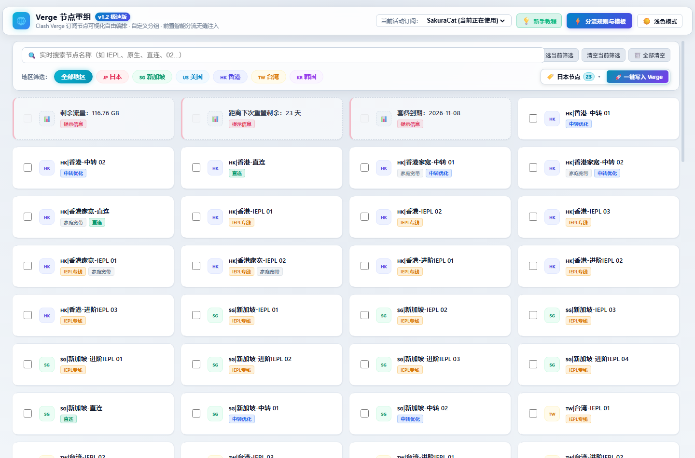
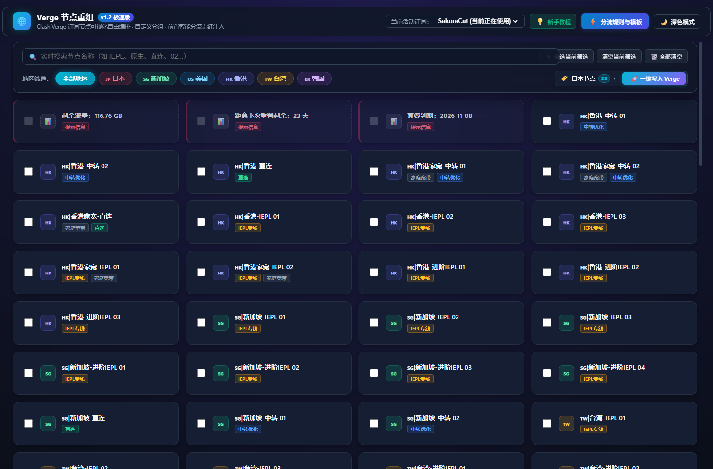
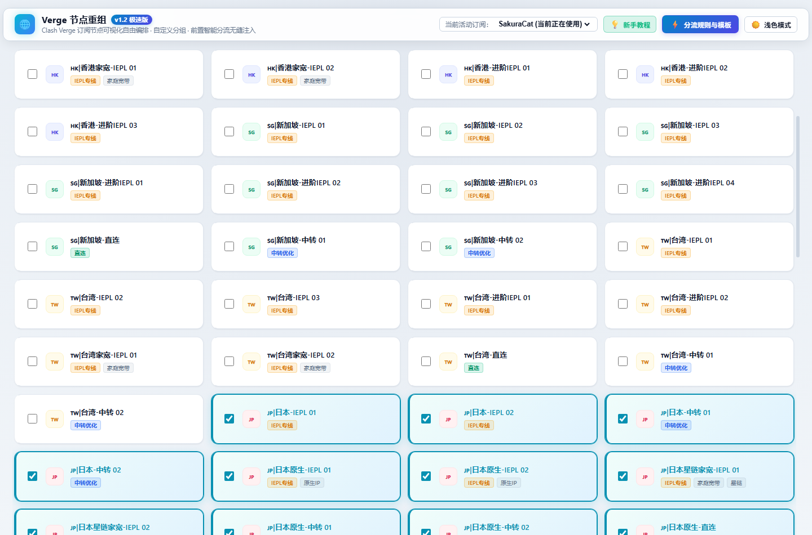
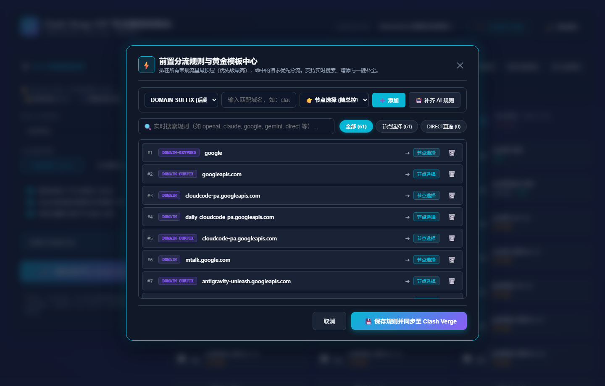
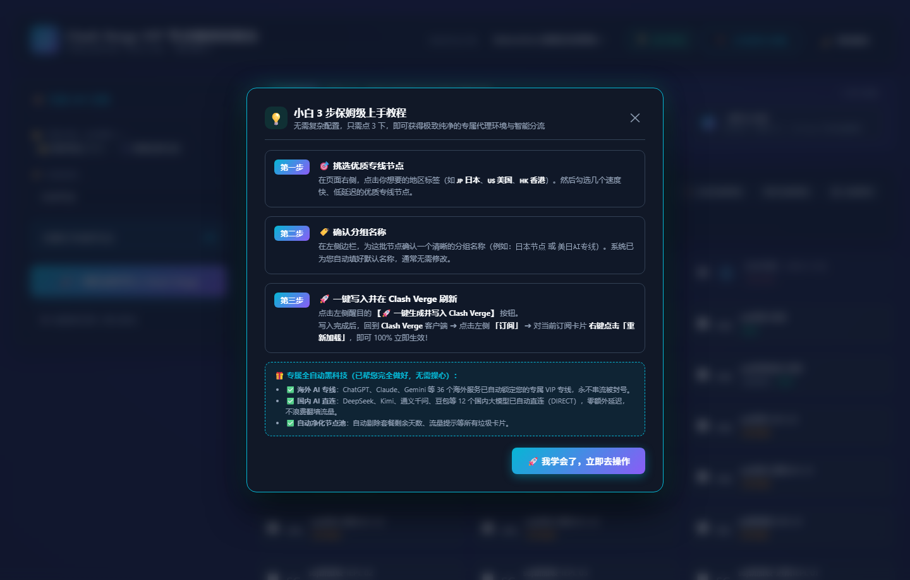
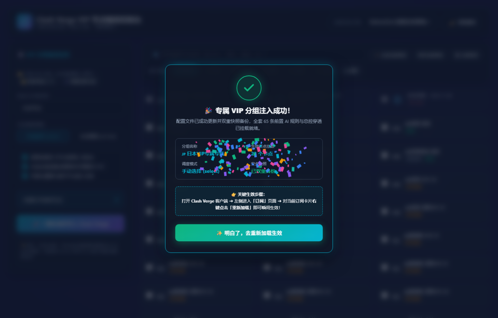

# 🌐 Verge 节点重组 (v1.2 极速版)

> **优雅、高效、零依赖的 Clash Verge 订阅节点可视化自由编排与前置智能分流注入工具**  
> 打开网页即可自由挑选心仪节点、自定义命名策略组并一键无缝注入 Clash Verge；内置前置 AI 黄金分流规则与假节点净化机制，让节点维护重归顺手从容。

---

## 💡 为什么需要 Verge 节点重组？

- **手改配置极易崩溃**：为了挑出几个稳定低延迟的好节点单列分组，不得不翻找操作系统深层 `AppData\Roaming` 目录去手写 YAML 规则，缩进多一个空格直接导致内核报错、客户端闪退；
- **假节点污染测速池**：机场订阅往往充斥着“剩余流量”、“套餐到期”、“重启网络”等非代理卡片。客户端默认开启自动测速或故障转移时，经常误选假节点导致全网断连；
- **规则与总出口割裂**：机场自带的主组和媒体分流各自为战，换了总出口，各类前置 AI 规则（Claude/Gemini/OpenAI）依然走默认甚至直连，无法随心统管；
- **缺乏可视化分组记忆**：每换一个新订阅或追加新机场，以往精心挑选的节点全部失效，缺乏对已有分组“一键回显、增删节点、秒级更新”的生命周期维护途径。

---

## ✨ 核心特性

- 🚀 **开箱即用 · 纯内置零依赖**：基于 Python 标准库构建轻量原生服务，不依赖任何第三方 pip 包，双击批处理脚本即可秒级唤醒；
- 🖥️ **App Shell 视口锁定布局**：采用现代桌面仪表盘架构，**全景通栏顶栏绝对置顶固化、不随页面滑动下拉**；下方内容区独立纵向平滑滚动，随时随地掌控操作；
- 🎨 **地区药丸与微徽章色彩全量同步**：🇯🇵 日本（樱花玫红）、🇭🇰 香港（典雅靛蓝）、🇸🇬 新加坡（薄荷翠绿）、🇺🇸 美国（晴空湛蓝）、🇹🇼 台湾（温暖琥珀橙）、🇰🇷 韩国（梦幻淡紫），筛选标签与卡片微徽章色彩 100% 呼应；
- 🌿 **单排 4 列黄金呼吸感网格**：彻底告别逼仄拥挤，每个节点名称、微徽章与专线/中转/家宽属性单行舒展呈现，兼具极高空间利用率与视觉通透感；
- 🔍 **300px 精致定宽搜索栏**：告别无节制的无限拉长，两翼通透对齐，彻底消除对快捷操作按钮的任何遮挡与文字挤压；
- ⚡ **国内外 AI 智能黄金分流底座**：内置 65 条前置黄金规则底座（国外 Claude / OpenAI / Gemini 强制走代理，国内 Kimi / DeepSeek / 智谱清言智能走直连），支持实时搜索与自定义新增；
- 💡 **小白保姆级 3 步教程内置**：主页常驻一目了然的 3 步操作横幅与全屏详细说明弹窗，新手无需查阅任何外部文档即可秒上手；
- 🔄 **已有 VIP 分组一键回显增删**：精准读取订阅配置中的自定义策略组，点击胶囊标签瞬间复原勾选，随意微调增删后一键覆盖生效；
- 🎆 **五彩礼花微交互与全量假节点过滤**：生成成功伴随全屏炫彩粒子动画与详细统计弹窗，自动从测速节点池中彻底净化非代理卡片。

---

## 📸 界面实测画廊 (Visual Gallery)

### ☀️ 浅色明亮模式（全景通栏顶栏 · 4 列舒展呼吸感）
> 纯净通透卡片设计，顶部通栏悬浮固化，地区色彩上下精准呼应。



### 🌙 暗夜深蓝极客模式 (Dark Mode)
> 科技感深邃微光背景，柔和磨砂发光微徽章，夜间专注护眼。



### 📌 顶栏吸顶固定实测（向下滚动不随页面下拉）
> 下方内容纵向自然滚动，顶栏稳如泰山悬浮置顶，右侧延伸出独立的精致细滚动条。



### ⚡ 前置分流规则与黄金模板管理大厅
> 实时搜索域名关键词、单排流线型排版、一键补全全套国内外 AI 分流规则。



### 💡 小白上手保姆级教程弹窗
> 3 步极简操作分解、进阶优势拆解，手把手引导新手完成初次配置。



### 🎆 一键注入成功与炫彩礼花动效
> 漫天彩色粒子喷发，弹出科技风确认卡片，直观呈现注入节点数与重载指引。



---

## 🚀 3 步极速上手指南

1. **一键启动**：
   直接双击运行根目录下的 **`启动控制台.bat`**，系统将自动启动后台常驻服务并唤起默认浏览器；
2. **勾选编排**：
   在浏览器打开的控制台中（`http://127.0.0.1:8899`）：
   - 顶部选择您的活动订阅；
   - 点击地区标签（如 `🇯🇵 日本`）快速筛选出心仪节点并直接勾选；
   - 在右侧胶囊确认或自定义分组名字（默认已为您预设好）；
   - 点击 **「🚀 一键写入 Verge」**；
3. **客户端刷新生效**：
   回到 Clash Verge 客户端，在 **「订阅」** 页面右键当前订阅卡片，点击 **「重新加载 (Reload)」** 即可立即生效！

---

## 📂 项目工程结构

```
VPNrules/
├── 启动控制台.bat              # 🚀 Windows 一键启动脚本 (自动拉起浏览器)
├── server.py                   # ⚙️ 本地 Python 轻量 API 服务 (标准库零依赖)
├── web/
│   └── index.html              # 🎨 Verge 节点重组现代单页控制台 (App Shell 视口架构)
├── docs/
│   └── images/                 # 📸 界面实测高清截图
├── .gitignore                  # 🛡️ 严格排除用户本地隐私备份与配置
├── LICENSE                     # 📄 MIT 开源许可证
└── README.md                   # 📖 产品化项目说明文档
```

---

## 📄 开源许可证

本项目基于 [MIT License](LICENSE) 开源发布，欢迎自由 Star、Fork 与提交 PR！
