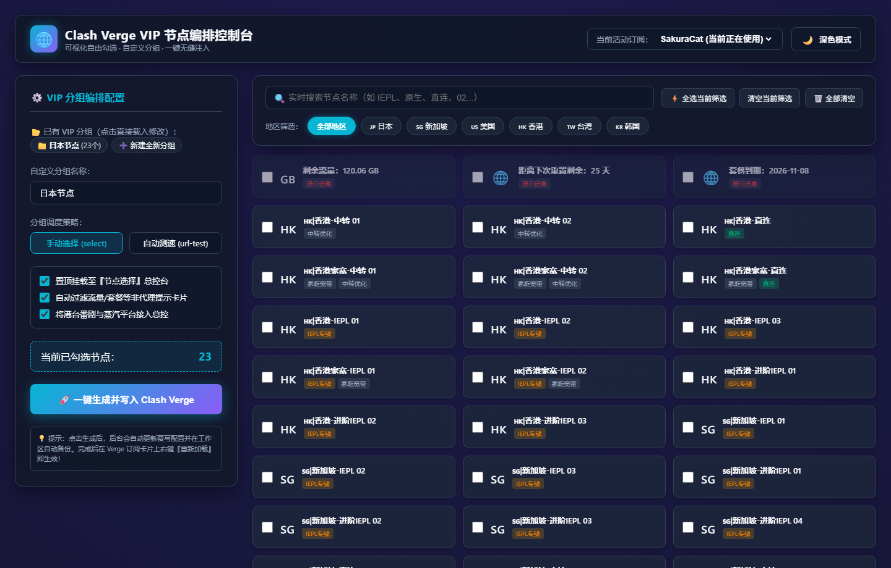
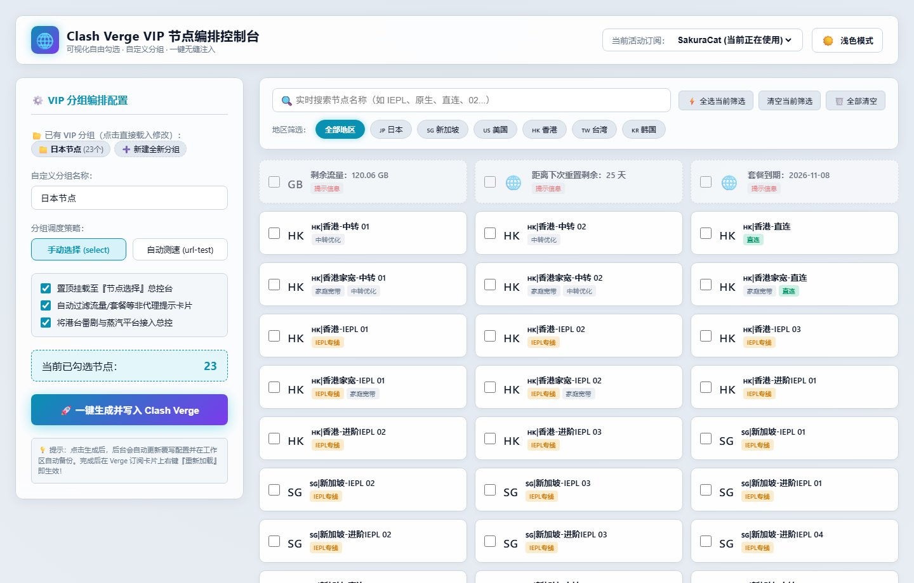
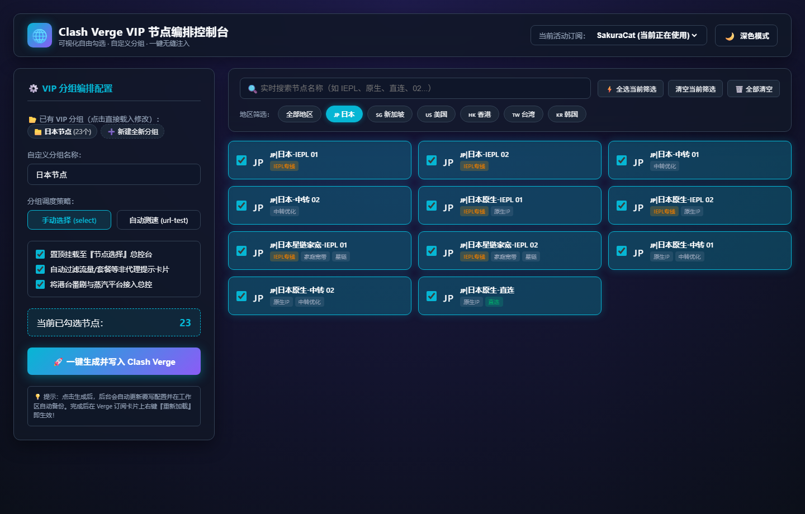
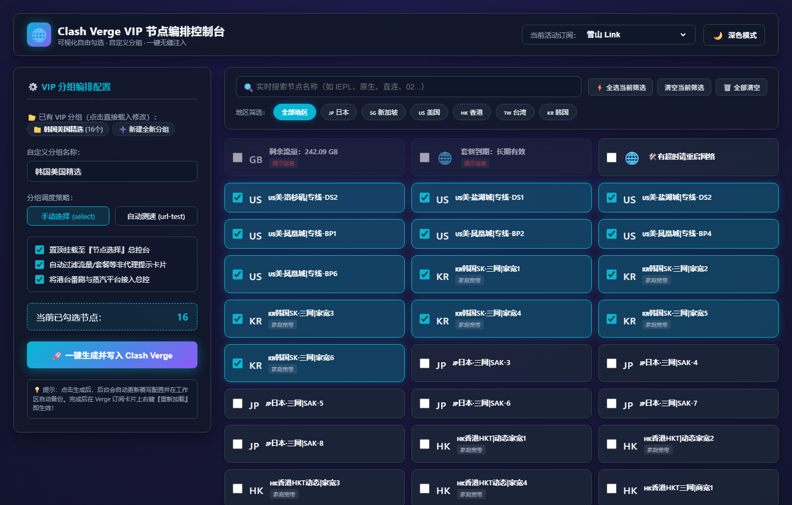

# 🌐 VPNrules · 把订阅节点变成“顺手好用”的专属分流组

> 打开网页直接勾选心仪的优质节点，自定义命名并一键保存，自动生成专属代理组。  
> Clash Verge 自动接管总出口并同步 AI 规则，再也不用翻深层目录手写 YAML，维护节点从未如此顺手。

---

## 😫 手动挑选与维护节点，为什么这么难用？

- **手动改配置极易报错**：想把几个好节点挑出来单列分组，必须翻找深层 Roaming 目录手改 YAML 覆写配置。缩进多一个空格直接导致内核崩溃报错闪退；
- **假节点严重污染测速**：机场订阅往往塞满“剩余流量”、“套餐到期”、“重启网络”等非代理卡片。自动测速或故障转移经常误选假节点导致全网断连；
- **规则与总出口割裂**：机场自带的主组和媒体分流默认各自为战，改了总出口，各类前置 AI 规则（Claude/Gemini/OpenAI）依然走默认甚至直连，难以统一管控；
- **新订阅无法快速复用**：每换一个新订阅或追加新机场，以往的配置全部推倒重来，缺乏对已有分组“一键回显、增删节点、秒级更新”的维护途径。

---

## ✨ 我们的做法

1. ① **本地秒级启动**：基于 Python 纯内置标准库编写，无需安装任何第三方依赖，双击脚本即可在后台静默常驻；
2. ② **可视化按需挑选**：支持深浅双色模式，按地区国旗和专线/家宽标签秒级过滤，勾选自选节点并一键命名；
3. ③ **已有分组一键回显**：自动识别已配置的 VIP 分组，点击标签瞬间复原已选节点，增删改查一目了然；
4. ④ **全自动总控与净化**：一键写入后自动挂载至总出口「节点选择」、打通核心 AI 规则，并从测速池中全局剔除假节点。

---

## 🖥️ 界面实测预览 (Screenshots)

### 🌙 暗夜深蓝极客模式 (Dark Mode)
> 科技感深邃渐变背景、霓虹高亮发光卡片、实时节点计数与快捷筛选。



### ☀️ 苹果风极简明亮模式 (Light Mode)
> 纯净立体卡片与柔和阴影，日间清爽护眼，支持一键秒切。



### 🇯🇵 地区国旗与协议标签秒级过滤
> 点击国旗标签或输入协议关键词（如 IEPL、星链家宽、原生IP），秒级过滤优质节点。



### 🔄 已有 VIP 分组一键回显载入与增删
> 自动识别当前订阅已有的自定义策略组，点击胶囊瞬间回显原先勾选，随时增删节点并无缝覆盖。



---

## 🚀 极简使用方式 (3 步上手)

1. **双击启动**：
   直接双击运行工程根目录下的 **`启动控制台.bat`**；
2. **浏览器点选**：
   系统会自动在浏览器打开 `http://127.0.0.1:8899`：
   - 顶部选择当前订阅；
   - 点击地区标签（如 `🇯🇵 日本`）快速筛选出所有日本节点；
   - 在心仪的优质节点上打勾，或点击已有分组回显增删；
   - 输入您自定义的分组名字（如 `我的日本VIP专线`）；
   - 点击 **「🚀 一键生成并写入 Clash Verge」**；
3. **客户端刷新生效**：
   回到 Clash Verge 客户端，在左侧 **「订阅」** 页面右键当前订阅卡片，点击 **「重新加载」** 即可！

---

## 📂 项目结构

```
VPNrules/
├── 启动控制台.bat      # 🚀 Windows 一键启动批处理脚本 (自动调起浏览器)
├── server.py           # ⚙️ 本地 Python 轻量 API 服务 (零外部依赖)
├── web/
│   └── index.html      # 🎨 现代化科技风单页 Web 控制台 (支持深浅双色模式)
├── docs/
│   └── images/         # 📸 控制台实测高清运行截图
├── .gitignore          # 🛡️ 严格过滤用户本地备份与配置隐私
├── LICENSE             # 📄 MIT 开源协议
└── README.md           # 📖 项目说明文档
```

---

## 📄 License

本项目基于 [MIT License](LICENSE) 开源发布。
