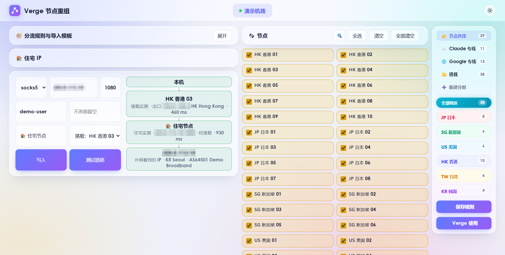
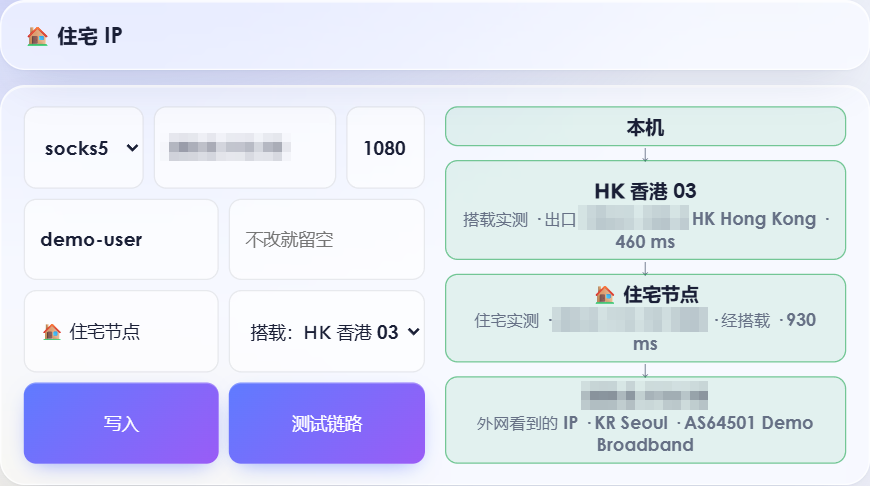
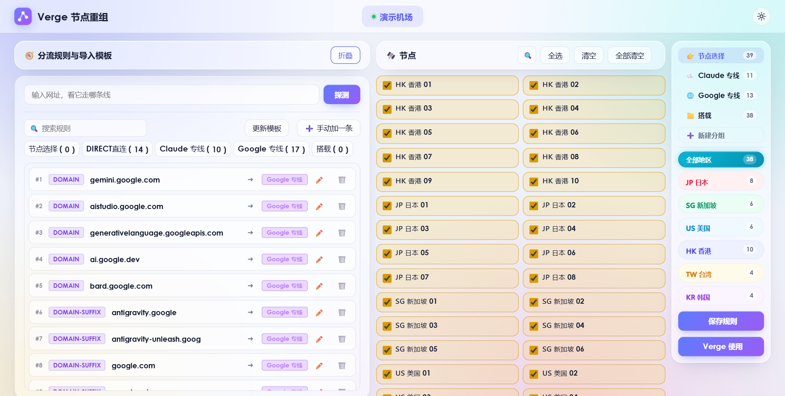
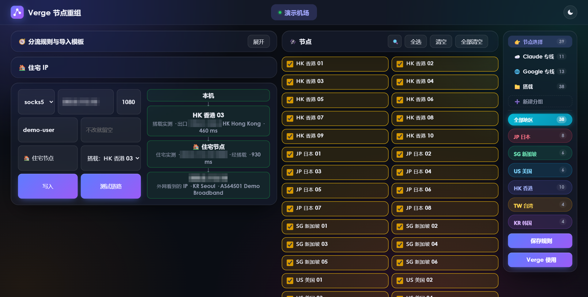
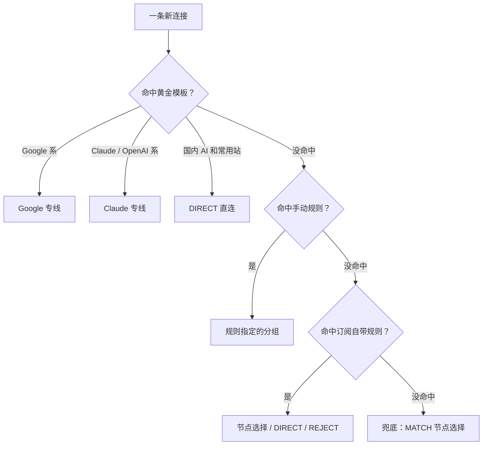
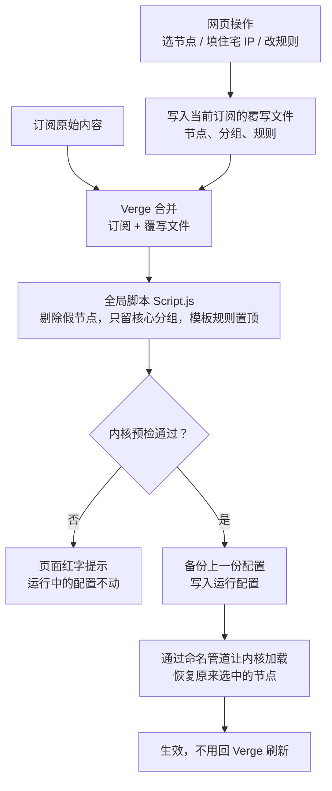
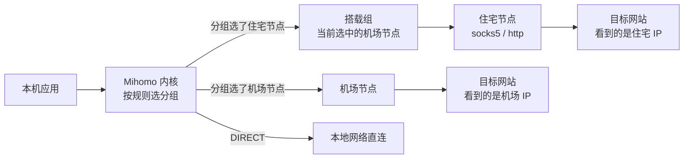
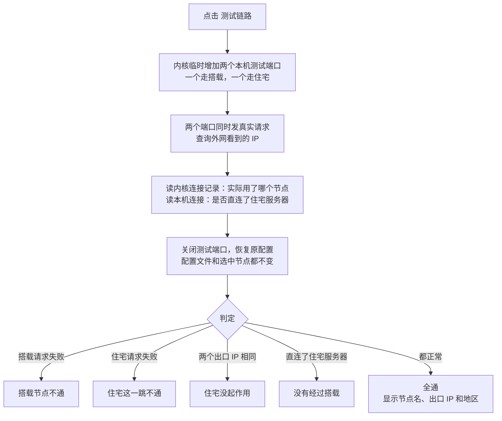

# Verge 节点重组 v2.0 (Clash Verge 住宅 IP 链路与分流控制台)

<p align="center">
  
  
  
  
  
</p>

同一个规则不能对所有分支都有效，所以内置 41 条**黄金模板**分流规则：Google 系走 Google 专线，Claude、OpenAI 走 Claude 专线，国内 AI 和常用网站直连，换订阅也不用重配。填一次住宅 IP，就得到“本机 → 机场节点 → 住宅 IP → 目标网站”的完整链路，配置直接生效，还能用真实请求测出这条线到底通不通。

---

## 快速使用

先装好客户端，再选一种方式启动控制台。

### 第一步：安装 Clash Verge Rev（⭐ 推荐客户端）

本工具专为 [Clash Verge Rev](https://github.com/clash-verge-rev/clash-verge-rev) 设计，直接读写它的订阅、分组、规则和脚本，其它客户端用不了。推荐它是因为它开源、使用 Mihomo 内核，节点链式代理和规则覆写都能用。

1. 从 [Clash Verge Rev Releases](https://github.com/clash-verge-rev/clash-verge-rev/releases/latest) 下载 Windows 安装包并安装；
2. 打开“订阅”页，导入你的机场订阅并设为当前；
3. 保持 Verge 运行。

### 第二步：启动控制台

#### 方式一：下载压缩包（⭐ 最推荐）

需要已安装 [Python 3](https://www.python.org/downloads/)。建议同时安装 [Node.js](https://nodejs.org/)：写入后直接生效要靠它运行脚本，没有的话配置照样保存，只是要回 Verge 刷新。

1. 从 [Releases 最新发布页](https://github.com/Kekeyo/VPNrules/releases/latest) 下载 `VPNrules-v2.0.2.zip` 并解压；
2. 双击 `启动控制台.bat`，首次运行会自动安装 PyYAML 和分流脚本；
3. **完成！** 浏览器会打开 `http://127.0.0.1:8899`，填住宅 IP，点 **写入**，再点 **测试链路**。

> 服务只监听本机 `127.0.0.1`，局域网和外网都访问不到。关掉启动窗口后服务继续在后台运行。

#### 方式二：从源码运行

```bash
git clone https://github.com/Kekeyo/VPNrules.git
cd VPNrules
pip install -r requirements.txt
python server.py
```

---

## 🖥️ 界面预览

> 截图中的订阅和节点都是演示数据，IP 已打码。

### 整体界面：测试后显示真实走线



### 住宅 IP 与链路测试



### 分流规则与黄金模板



### 深色模式



---

## 🎯 网络命中规则：黄金模板

**为什么要分支**：同一个规则不能对所有分支都有效。适合 Google 的节点未必适合 Claude，国内网站又应该直连，全部流量走一个总出口，改好这边就会影响那边。

所以有了**黄金模板**：41 条规则排在所有规则最前面，把流量分到 Google 专线、Claude 专线和直连，其余走节点选择，每条分支各选各的节点。所有订阅通用，换机场、加订阅都不用重配。

### 黄金模板分流

| 去向 | 匹配内容 | 数量 |
|:---|:---|---:|
| **Google 专线** | Gemini、AI Studio、`google.com`、`googleapis.com`、YouTube 等 | 17 |
| **Claude 专线** | `anthropic.com`、`claude.ai`、`openai.com`、`chatgpt.com`，<br>以及域名中含 `anthropic`、`claude`、`openai` 的 | 10 |
| **DIRECT** | DeepSeek、豆包、Kimi、智谱、MiniMax，<br>百度、QQ、B 站、淘宝、京东、网易 | 14 |

### 匹配顺序

内核**从上往下逐条匹配，命中第一条就停**，后面的规则不再看。

| 顺序 | 层级 | 来源 | 说明 |
|:---:|:---|:---|:---|
| 1 | **黄金模板** | `Script.js` | 41 条，所有订阅相同，优先级最高 |
| 2 | **手动规则** | 页面“手动加一条” | 只对当前订阅生效 |
| 3 | **订阅自带规则** | 机场 | 指向已删除分组的，改走“节点选择” |
| 4 | **兜底规则** | 订阅里的 `GEOIP` / `MATCH` | 通常是中国 IP 直连，其余走“节点选择” |



### 命中示例

| 访问 | 命中规则 | 去向 |
|:---|:---|:---|
| `gemini.google.com` | `DOMAIN,gemini.google.com` | Google 专线 |
| `www.youtube.com` | `DOMAIN-SUFFIX,youtube.com` | Google 专线 |
| `api.anthropic.com` | `DOMAIN-SUFFIX,anthropic.com` | Claude 专线 |
| `chatgpt.com` | `DOMAIN-SUFFIX,chatgpt.com` | Claude 专线 |
| `my-claude-tools.example` | `DOMAIN-KEYWORD,claude` | Claude 专线 |
| `www.deepseek.com` | `DOMAIN-SUFFIX,deepseek.com` | DIRECT |
| `github.com` | 模板未命中，看订阅规则 | 取决于订阅 |

### 分组里有什么

| 分组 | 成员 | 用途 |
|:---|:---|:---|
| **节点选择** | 全部真实节点 | 总出口，订阅规则的默认去向 |
| **Google 专线** | 默认日本、台湾节点，<br>外加节点选择、DIRECT | Google 全家 |
| **Claude 专线** | 默认韩国、美国节点，<br>外加节点选择、DIRECT | 海外 AI |
| **搭载** | 除住宅外的全部机场节点 | 住宅节点的前一跳，不含住宅所以不会成环 |

---

## 😫 我们要解决的痛点

| 痛点 | 实际发生了什么 | v2.0 的做法 |
|:---|:---|:---|
| **同一个规则不能对所有分支都有效** | 所有流量走一个总出口，<br>换节点照顾了一个服务，就影响另一个 | 黄金模板分出 Google 专线、Claude 专线、<br>直连和节点选择，各走各的 |
| **机场出口不够稳**<br>*账号类服务尤其明显* | 机场节点是多人共用的机房 IP，<br>想让 Claude 等服务固定走一个住宅出口 | 专线分组里直接选住宅节点，<br>其它流量不受影响 |
| **住宅 IP 配置门槛高** | 要手写 `dialer-proxy`、建前置分组，<br>分组一旦包含住宅自己就成环 | 填 IP、端口和账号，<br>节点、分组、防成环全自动 |
| **写完还要回 Verge 刷新** | v1 写入后要到客户端手动重新加载，<br>漏一步就以为没生效 | 点 **Verge 使用** 直接进内核，<br>选中的节点不变 |
| **一处写错整个代理挂掉** | 例如分组丢了，内核报<br>`dialer-proxy [搭载] not found` | 先用内核预检，不通过就红字提示，<br>运行中的配置不动 |
| **界面显示不等于实际走线** | 延迟通不代表出口是住宅，<br>页面上选的也未必是内核在用的 | 真实请求走运行中的内核，<br>节点名和出口 IP 都来自实测 |
| **换订阅就要重来** | 机场自带几十个分组，规则指向分散，<br>假节点还混在里面 | 只留 4 个核心分组，<br>新订阅自动套用同一套结构 |
| **规则模板改起来麻烦** | 黄金模板写在脚本里，<br>只能打开文件手改 | 页面调好后点 **更新模板** 存成统一模板，<br>其它订阅点 **复制模板** 拿来覆盖 |

---

## 🆙 相比 v1 更新了什么

v1 解决的是“把节点挑出来分组”，v2.0 解决的是“整条线路配好、生效、验证”。

| 能力 | v1 | v2.0 |
|:---|:---|:---|
| **住宅 IP 链路** | ❌ 没有 | ✅ 表单写入，自动挂到搭载节点后面 |
| **生效方式** | ⚠️ 回 Verge 手动重新加载 | ✅ 通过内核接口直接加载 |
| **写入前检查** | ❌ 没有 | ✅ 内核预检，并备份上一份配置 |
| **链路测试** | ❌ 没有 | ✅ 真实请求，显示搭载节点、住宅节点和出口 IP |
| **分组结构** | ⚠️ 自选分组叠加在机场分组上 | ✅ 节点选择、Google 专线、Claude 专线、搭载 |
| **规则模板** | ⚠️ 固定内置 | ✅ 页面一键更新和复制模板 |
| **规则命中测试** | ❌ 没有 | ✅ 输入域名，查看命中哪条规则 |
| **节点解析** | ⚠️ 正则匹配，分组可能被当成节点 | ✅ 按 YAML 结构解析 |
| **依赖** | Python 标准库 | ⚠️ 新增 PyYAML，启动脚本自动安装 |

v1 的代码和截图保留在 [v1.0 标签](https://github.com/Kekeyo/VPNrules/tree/v1.0)。

---

## 🧭 流程图

### 从填写到生效



### 流量怎么走



### 测试链路做了什么



---

## 🛠️ 核心痛点与避坑实战

**手动规则为什么没生效？**
➔ 模板排在手动规则前面，同一个域名模板先命中。要改这类域名的去向，在页面调好后点 **更新模板**。

**新订阅进来要做什么？**
➔ 在 Verge 添加订阅并设为当前，脚本会自动套用 4 个核心分组和模板规则。要用住宅链路，再到网页填一次表单。

**写入后提示“已保存，到 Verge 里切换或刷新”？**
➔ 配置已保存，但这次没能直接生效。常见原因是改的不是 Verge 正在用的订阅、电脑没有 Node.js，或者订阅的 Merge 里有自定义内容。按提示到 Verge 切换或刷新一次即可。

**测试显示“住宅这一跳不通”？**
➔ 搭载节点是通的，先检查住宅 IP、端口和账号，或者住宅服务是否到期。

**配置坏了怎么恢复？**
➔ 每次写入前都会备份到 `backup/`。

**首次启动对已有脚本有影响吗？**
➔ 全局脚本为空或仍是默认内容时才会自动安装；如果你已经写了自己的全局脚本，不会被覆盖，需要手动把 `Script.js` 的内容合并进去。

---

## 🔒 隐私与安全

- 住宅账号密码只写入本机 Verge 配置目录，不上传；
- 仓库和压缩包不含订阅、节点、账号或运行日志，`backup/`、`*.yaml`、`*.log` 均已排除；
- 所有接口校验 Host，写操作再校验 Origin，其它网页读不到也改不了你的配置；
- 测试链路会访问 `ipinfo.io` 和 `ip-api.com` 查询出口 IP，只在点击测试时发生。

---

## ⚠️ 已知限制

- 只支持 Windows：内核控制依赖 Verge 的命名管道；
- “经搭载”是推断结果：内核连接记录只显示住宅节点，所以结合“本机没有直连住宅服务器”和配置中的 `dialer-proxy` 判定；
- 每次测试内核会加载两次配置，通常现有连接不受影响；
- TUN 模式开启时，测试结果可能不准，页面会提示；
- 目前实测覆盖的是全通路径，失败判定还没有在真实断线环境下逐项验证。

---

## 📁 目录结构

```text
VPNrules/
├── 启动控制台.bat       # 启动入口：装依赖、后台拉起服务、打开浏览器
├── server.py            # 本地服务：读写配置、内核预检、加载、链路测试
├── Script.js            # Verge 全局脚本：分组结构和黄金模板规则
├── requirements.txt     # PyYAML
├── web/
│   ├── index.html       # 控制台页面
│   └── page-update-notify.js
└── LICENSE
```

---

## 📄 开源许可证

[MIT License](LICENSE)
