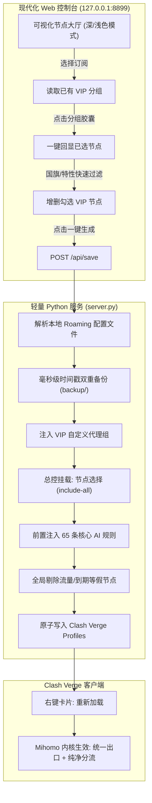

# ⚡ VPNrules · 把杂乱机场节点变成“一键直达”的专属 VIP 总控池

<div align="center">


</div>

> 打开本地 Web 控制台，像挑自选股一样勾选你的优质节点（日本专线、美韩家宽、IEPL），自定义命名分组并一键写入。告别手动手写 YAML 缩进报错噩梦，Clash Verge 自动接管总出口、打通 AI 规则并彻底净化掉假节点。

---

## 😫 机场订阅与 Clash 规则，为什么这么折磨人？

- **手动手写 YAML 极易报错**：想把几个好用的优质节点挑出来单列一个专属分组，必须翻找 Roaming 深层目录、改 YAML 覆写配置。缩进多一个空格直接导致内核崩溃报错闪退，维护极其繁琐；
- **假节点污染自动测速与分流**：机场订阅往往塞满“剩余流量: 200G”、“套餐到期: 2026-11”、“重启网络”等非代理卡片。URL-Test 自动测速或故障转移经常误选这些假节点，导致整个代理网络瞬间瘫痪；
- **总出口与核心规则严重脱节**：订阅自带的主组（如 `雪山 Link`、`SakuraCat`）和媒体分组（港台番剧、Steam 社区）默认各自为战，无法跟随总出口「节点选择」统一调度；改了总出口，各类前置 AI 规则（Gemini/Claude/OpenAI）却依然走默认策略甚至直连，难以形成统一出口 IP 控制；
- **新订阅每次都要重新折腾**：每换一个新订阅或追加新机场，以往的配置全部推倒重来，无法对已有分组实现“一键回显、增删节点、秒级更新”的生命周期管理。

---

## ✨ 我们的做法

1. ① **本地纯净解析与零依赖启动**：基于 Python 3 纯内置标准库（`http.server`、`json`、`re`），无需安装任何 `pip` 第三方包，双击批处理即可在后台无窗口常驻运行；
2. ② **现代化可视化编排**：提供暗夜深蓝极客与苹果风极简明亮双模式，按国家国旗（🇯🇵、🇸🇬、🇺🇸、🇭🇰 等）与协议特性（IEPL专线、原生IP、家庭宽带）秒级过滤，勾选自选节点并一键命名；
3. ③ **已有分组生命周期管理**：自动识别订阅中已有的自定义策略组，点击胶囊标签瞬间回显原先勾选的节点状态，随时增删节点或改名，同名无缝平滑覆写；
4. ④ **全自动总控接入与智能穿透**：生成的 VIP 分组自动挂载至总出口「节点选择」（开启 `include-all: true` 全量聚合），并自动前置注入 65 条前置 AI 核心规则、同步打通机场主组与媒体分流，国内流量继续坚挺保持白名单 DIRECT 直连；
5. ⑤ **全局垃圾假节点净化**：通过智能过滤算法，自动将所有分组中的流量统计、到期提醒等假节点剔除出测速池；
6. ⑥ **毫秒级时间戳双重备份**：每次保存前，自动在本地 `backup/` 和客户端配置目录同步生成毫秒级时间戳备份快照，杜绝误操作风险。

---

## 🧭 系统工程全景与核心流转



---

## 🖥️ 界面实测预览 (Screenshots)

### 🌙 暗夜深蓝极客模式 (Dark Mode)
> 科技感深邃渐变背景、霓虹高亮发光卡片、实时节点计数与快捷筛选。


### ☀️ 苹果风极简明亮模式 (Light Mode)
> 纯净立体卡片与柔和阴影，日间清爽护眼，支持一键秒切。


### 🇯🇵 地区国旗与协议标签秒级过滤
> 点击国旗标签或输入协议关键词（如 IEPL、星链家宽、原生IP），秒级过滤优质节点。


### 🔄 已有 VIP 分组一键回显载入与增删
> 自动识别当前订阅已有的自定义策略组，点击胶囊瞬间回显原先勾选，随时增删节点并无缝覆盖。


---

## 🚀 极简使用方式 (3 步上手)

1. **双击启动**：
   直接双击运行工程根目录下的 **`启动控制台.bat`**；
2. **浏览器点选**：
   系统会自动在浏览器打开 `http://127.0.0.1:8899`：
   - 顶部选择当前订阅；
   - 点击地区标签（如 `🇯🇵 日本`）快速筛选出所有日本节点；
   - 在心仪的优质节点上打勾，或点击已有分组回显增删；
   - 输入您自定义的分组名字（如 `我的日本VIP专线`）；
   - 点击 **「🚀 一键生成并写入 Clash Verge」**；
3. **客户端刷新生效**：
   回到 Clash Verge 客户端，在左侧 **「订阅」** 页面右键当前订阅卡片，点击 **「重新加载」** 即可！

---

## 📂 项目结构

```
VPNrules/
├── 启动控制台.bat      # 🚀 Windows 一键启动批处理脚本 (自动调起浏览器)
├── server.py           # ⚙️ 本地 Python 轻量 API 服务 (零外部依赖)
├── web/
│   └── index.html      # 🎨 现代化科技风单页 Web 控制台 (支持深浅双色模式)
├── docs/
│   └── images/         # 📸 控制台实测高清运行截图
├── .gitignore          # 🛡️ 严格过滤用户本地备份与配置隐私
├── LICENSE             # 📄 MIT 开源协议
└── README.md           # 📖 项目说明文档
```

---

## 📄 License

本项目基于 [MIT License](LICENSE) 开源发布。
